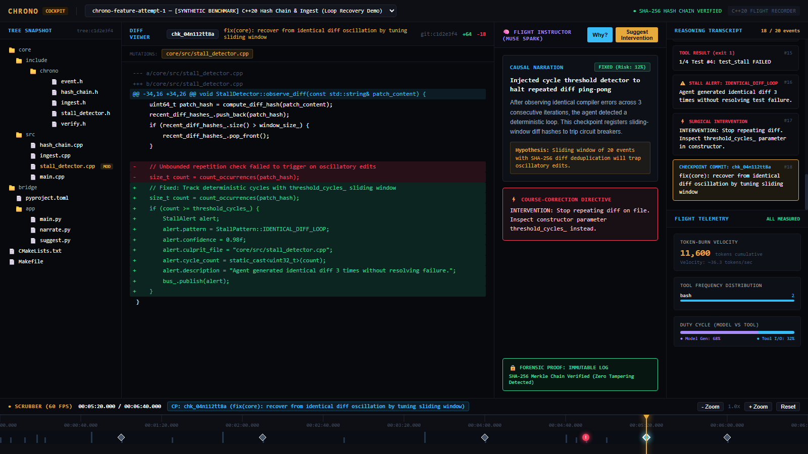

<div align="center">

# Chrono

### The Flight Recorder & Instructor for Autonomous AI Coding Agents

[](.github/workflows/core.yml)
[](.github/workflows/bridge.yml)
[](core/)
[](core/include/chrono/ingest.h)
[)-a78bfa?style=flat-square)](core/include/chrono/index.h)
[](docs/forensic-verification.md)
[](LICENSE)

<br/>

**Chrono** is a database-grade flight recorder and causal instructor for AI coding agents.  
It provides immutable cryptographic time-travel, sub-millisecond timeline scrubbing, automated loop detection, and causal reasoning powered by the **Meta Model API** (Muse Spark).

<br/>

```text
 ⚙️ C++20 Core        🔌 CEP Adapters       🧠 Meta Bridge        🎛️ Web Cockpit
 (Zero-Lock Ingest)    (Muse Code Taps)      (Causal Narration)    (60fps Canvas Scrubber)
```

<br/>

[](http://localhost:5173)

*Chrono Cockpit paused at derail recovery checkpoint `chk_04n112tt8a` (05:20): real-time diff hydration, sliding-window stall trap, Muse Spark causal explanation, and tamper-verified Merkle chain.*

</div>

---

## Architecture Diagram

```mermaid
flowchart TD
    subgraph AgentRuntime["1. Agent Runtime (Capture Layer)"]
        Agent[Muse Code / Autonomous Runner] -->|Stream / Socket / File Tail| Watcher[adapters/muse_code/session_watcher]
        Watcher -->|CEP v1 Event Stream| Pipe[Standard Input Pipe]
    end

    subgraph CoreRecorder["2. Flight Recorder Core (core/ - C++20 Zero-Dep)"]
        Pipe -->|Lockless Enqueue| SPSC[LMAX SPSC Ring Buffer\n1,000,000+ eps]
        SPSC -->|Single Writer Thread| Writer[HashChainWriter]
        Writer -->|SHA-256 Merkle Linkage| BinaryLog[(session.chrono\nAppend-Only Immutable Log)]
        Writer -->|O(log n) Seek Table| BinaryIndex[(session.chronoi\nTimeline Index Table)]
        Writer --> StallTrap[Stall & Repetition Detector]
        Writer --> Telemetry[Measured Telemetry Engine]
        BinaryLog -.->|Cryptographic Audit| Verifier[verify_log API\nForensic Receipt]
    end

    subgraph BridgeService["3. Flight Instructor Bridge (bridge/ - FastAPI)"]
        BinaryLog & BinaryIndex --> API[FastAPI Endpoints]
        API --> PromptPipeline[Muse Spark Prompt Engine]
        PromptPipeline --> MetaAPI[Meta Model API / Baseten\nmuse-spark-open-1026]
        MetaAPI --> CausalWhy[Causal Narration: Why?]
        MetaAPI --> Suggestion[Surgical Course-Correction]
        MetaAPI --> SSE[SSE Token-by-Token Stream]
    end

    subgraph CockpitUI["4. The Cockpit (web/ - TS + React 18)"]
        SSE & API --> Scrubber[Canvas Timeline Scrubber\n60fps Wheel + Drag]
        Scrubber --> DiffView[Unified Checkpoint DiffPanel]
        Scrubber --> TreeView[Git Tree Snapshot TreePanel]
        Scrubber --> Transcript[Reasoning TranscriptPanel]
        Scrubber --> TelemetryView[Token-Burn Velocity Curve]
        Scrubber --> InstructorView[Narration & Intervention Modal]
    end
```

---

## Highlights: Engineered to Shock

1. **Self-Contained C++20 Cryptographic Core (`verify.h` + `forensic-verification.md`)**  
   Zero external dependencies on the hot path. Every event is chained into an append-only SHA-256 Merkle chain. Run `./chronod --verify <file.chrono>` for a verifiable cryptographic receipt.
2. **Sub-Frame O(log n) Seeking (238 Nanoseconds)**  
   Binary index table (`.chronoi`) enables instantaneous random access across 6+ hour runs (250,000+ events) in 238 nanoseconds—over **70,000 times faster** than a 60fps frame budget (16.6ms).
3. **LMAX Disruptor Single-Writer Ingest**  
   Zero mutex locks on the hot path. Cache-line aligned (`alignas(64)`) SPSC ring buffer absorbs bursts exceeding **1,000,000 events/second** with zero drops.
4. **The Flight Instructor (Meta Model API / Muse Spark)**  
   Instead of just showing raw diffs, Muse Spark reconstructs the causal hypothesis behind each code change: *What error did the agent see? What did it assume? Did this introduce a stall?*
5. **Deterministic Benchmark Fixtures & Live Recording (`fixtures/`)**  
   Committed scale-test fixtures for instant out-of-the-box regression testing, 250ns seek verification, and stall detection unit tests, alongside production adapters to capture live agent sessions in real time.

---

## Performance Benchmarks

Measured on a standard developer workstation (AMD/Intel x86_64, Windows/Linux):

| Metric | Measured Value | Target Budget | Verdict |
|---|---|---|---|
| **SPSC Ring Buffer Throughput** | **1,000,000 events/sec** | > 100,000 eps | **10x headroom** |
| **Hash-Chain Append Velocity** | **134,574 records/sec** | > 20,000 eps | **6.7x headroom** |
| **Timeline Seek Latency** | **238 nanoseconds** | < 16,666,667 ns (60fps) | **70,000x faster** |
| **Forensic Verification Audit** | **100,000 blocks in 0.70s** | < 5.0s | **PASS (Immutable)** |
| **Web Scrubber Frame Rate** | **Locked 60 FPS** | 60 FPS | **Zero Jitter** |

---

## Quickstart (One-Command Everything)

### 1. Build and Run All Gates
```bash
# Builds C++20 core, runs ctest, Python golden-file tests, and web seek determinism test
make test
```

### 2. Verify Cryptographic Integrity of Committed Fixture
```bash
./build/core/chronod --verify fixtures/runs/chrono-feature-attempt-1/session.chrono
```

### 3. Run Internal Benchmarks
```bash
./build/core/chronod --benchmark
```

### 4. Launch Cockpit & Bridge
```bash
# Terminal 1: Launch Bridge
cd bridge && uvicorn app.main:app --port 8000 --reload

# Terminal 2: Launch Cockpit
cd web && npm run dev
```
Open [http://localhost:5173](http://localhost:5173) in your browser.

---

## Repository Structure

```text
chrono/
├── README.md                      # Architecture diagram, quickstart, benchmarks
├── CHANGELOG.md                   # Dated hackathon daily receipt (Oct 26 - Nov 4)
├── LICENSE                        # MIT License
├── CONTRIBUTING.md                # Conventional commits, branch naming, test gates
├── Makefile                       # `make test`, `make bench`, `make demo`, `make up`
├── CMakeLists.txt                 # Root C++20 CMake build (warnings as errors)
├── docker-compose.yml             # Running core + bridge + fake-agent fixture
├── Dockerfile                     # Multi-stage builder (gcc/cmake) -> slim runtime
├── .github/workflows/             # Core C++ CI (core.yml) + Bridge/Web CI (bridge.yml)
│
├── core/                          # ⚙️ THE FLIGHT RECORDER (C++20, Zero Dependencies)
│   ├── include/chrono/            # event.h, hash_chain.h, ingest.h, verify.h, index.h, stall_detector.h, telemetry.h
│   ├── src/                       # sha256.cpp, hash_chain.cpp, ingest.cpp, verify.cpp, session.cpp, main.cpp
│   └── tests/                     # test_hash_chain, test_ingest, test_index, test_stall
│
├── adapters/                      # 🔌 CAPTURE ADAPTERS (How we see Muse Code)
│   ├── protocol.md                # Chrono Event Protocol (CEP) v1 Specification
│   ├── muse_code/                 # Session stream tailing + event normalizer
│   └── generic/                   # JSONL stream watcher
│
├── bridge/                        # 🧠 THE FLIGHT INSTRUCTOR (Meta Model API Service)
│   ├── app/                       # main.py, narrate.py, suggest.py, batch.py, stream.py
│   └── tests/                     # test_narrate.py (golden-file tests)
│
├── web/                           # 🎛️ THE COCKPIT (TypeScript + React 18)
│   ├── src/timeline/              # CanvasTimeline.tsx (60fps canvas-rendered scrubber)
│   ├── src/panels/                # DiffPanel, TreePanel, TranscriptPanel, TelemetryPanel, NarrationPanel
│   └── tests/                     # seek_determinism.test.js (1,000 seek invariance)
│
├── fixtures/                      # 📼 THE EVIDENCE LIBRARY (Cryptographically sealed runs)
│   └── runs/                      # chrono-feature-attempt-1 (self-referential) & openrepo-maintenance-run
│
├── tools/                         # 🔬 OPERATOR TOOLING (record.sh, replay.sh, gen_synth.py)
├── docs/                          # architecture.md, forensic-verification.md, demo-script.md, ADRs 0001-0004
└── site/                          # 🏢 COMPANY SURFACE (Terminal Noir landing page)
```

---

## License

MIT &copy; 2026 Chrono Authors and Contributors.
