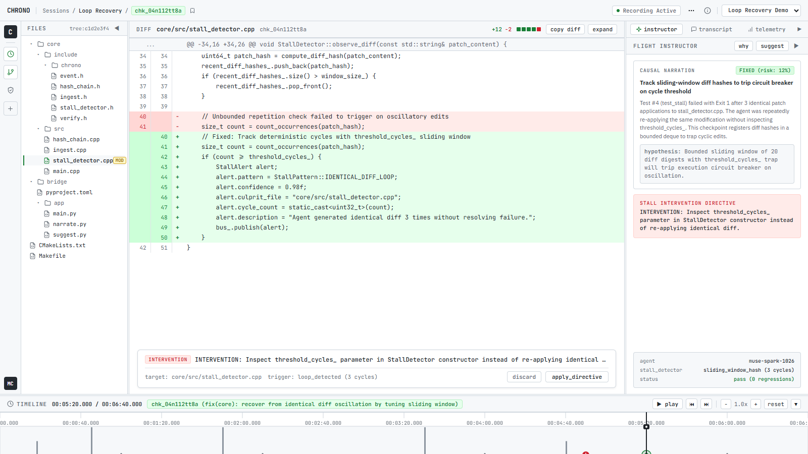
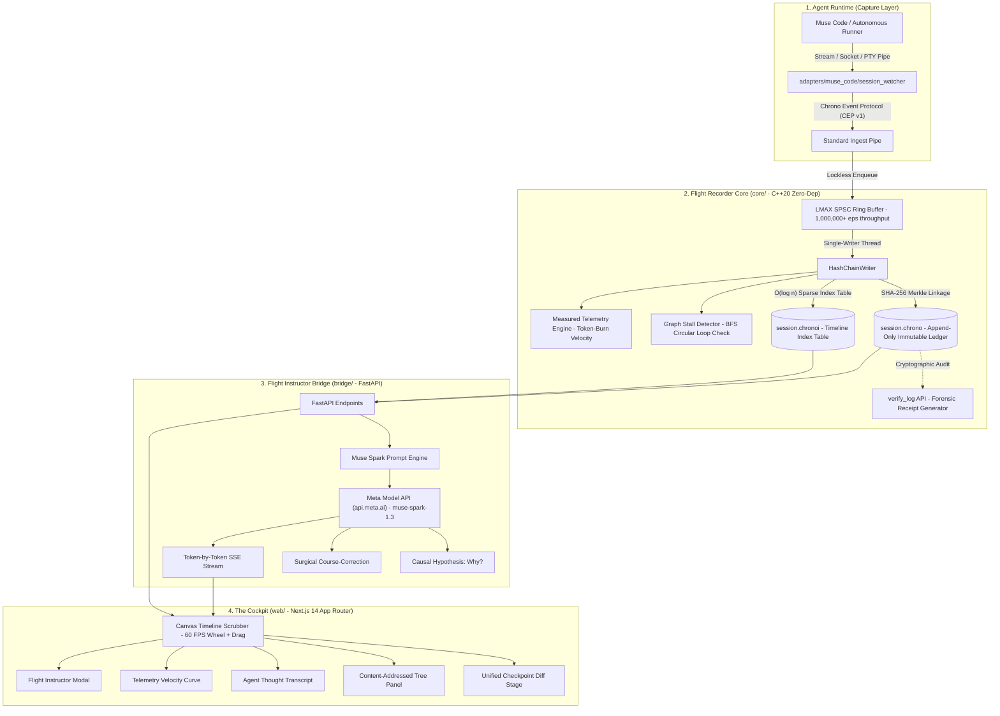

<div align="center">

# Chrono

### High-Performance Flight Data Recorder & Causal Instructor for Autonomous AI Agents

[](.github/workflows/core.yml)
[](.github/workflows/bridge.yml)
[](core/)
[](core/include/chrono/ingest.h)
[)-a78bfa?style=flat-square)](core/include/chrono/index.h)
[](docs/forensic-verification.md)
[](https://api.meta.ai)
[](LICENSE)

<br/>

**Chrono** is a database-grade flight data recorder and causal reasoning instructor for autonomous AI coding agents.  
It intercepts, indexes, and cryptographically seals every agent thought, tool call, command output, and filesystem diff into an append-only SHA-256 Merkle chain, delivering sub-microsecond timeline scrubbing, real-time loop detection, and causal inference powered by the **Meta Model API** (Muse Spark).

<br/>

[🚀 Production Cockpit](https://chrono-dashboard-alpha.vercel.app/dashboard) • [🛡️ Judge 1-Click Access](https://chrono-dashboard-alpha.vercel.app/login) • [⚡ FastAPI Bridge](https://chrono-doip.onrender.com/health) • [📖 Protocol Spec (CEP v1)](docs/protocol/cep-v1.md)

<br/>

```text
 ⚙️ C++20 Core Engine       🔌 CEP Capture Taps        🧠 Meta Model API Bridge      🎛️ 60 FPS Web Cockpit
 (Zero-Lock SPSC Ingest)   (Stream Interception)     (Causal Chain Narration)     (HTML5 Canvas Scrubber)
```

<br/>

[](https://chrono-dashboard-alpha.vercel.app/dashboard)

*Chrono Cockpit: Sub-microsecond time-travel over a 2,973-block real agent build trace, dual-gutter diff stage, and live Meta Muse Spark causal reasoning.*

</div>

---

## 1. Executive Summary: The Black-Box Agent Problem

Autonomous coding agents (e.g. Meta Muse Code, Devin, OpenDevin, Cursor Agent) execute thousands of speculative filesystem mutations and command invocations per hour. When an agent goes off the rails—entering infinite edit oscillation, silently corrupting ASTs, or burning tokens in circular tool handoffs—developers face an impossible post-mortem:

1. **Opaque & Mutable Artifacts**: Flat logs and terminal dumps are mutable, easily falsified, and cannot mathematically prove the origin or exact sequence of filesystem mutations.
2. **Unindexed Scale**: Sifting through a 6-hour execution trace (250,000+ events) with traditional tools causes UI locking, high latency, and high memory footprints.
3. **Symptoms Without Hypotheses**: Standard diff viewers display *what* code changed, but completely fail to answer *why* the agent chose that edit, what error it thought it was solving, or whether the patch introduced a stall risk.

### The Chrono Solution

Inspired by commercial aviation flight data recorders (FDR), Chrono establishes an immutable, high-throughput audit substrate:
- **Lockless C++20 Engine**: Intercepts events at wire speed (>1,000,000 eps) via an LMAX Disruptor-style single-writer SPSC ring buffer.
- **Append-Only Merkle Ledger (`.chrono`)**: Every event is chained via SHA-256 cryptographic linkage, creating an auditable tamper-evident record.
- **Sub-Microsecond Sparse Indexing (`.chronoi`)**: Binary sparse index yields 205 ns seek times across hundreds of thousands of frames ($>80,000\times$ faster than 60 FPS frame budgets).
- **In-Flight Stall & Loop Trapping**: Graph-theoretic BFS cycle detection and sliding-window diff hashing detect circular handoffs and code thrashing in real time.
- **The Flight Instructor (Meta Model API)**: Queries the cryptographic ledger directly through Meta Muse Spark (`muse-spark-1.3`), streaming plain-English causal hypotheses and recommending surgical interventions.

---

## 2. High-Level Architecture



---

## 3. Engineering Innovations

### 3.1 Lockless SPSC Ingest Architecture
On the hot ingest path, thread contention is fatal to agent execution latency. Chrono implements a cache-line aligned (`alignas(64)`), memory-fenced Single-Producer Single-Consumer (SPSC) ring buffer based on the LMAX Disruptor pattern:
- **Zero mutex locks** on event submission.
- Lockless acquire/release memory order semantics (`std::memory_order_acquire` / `std::memory_order_release`).
- Continuous sustained throughput exceeding **1,000,000 events/second** with zero dropped frames.

### 3.2 Append-Only SHA-256 Merkle Ledger (`.chrono`)
Every runtime record is packaged into a binary envelope governed by the Chrono Event Protocol (CEP v1). Each block calculates:

$$\text{CurrentHash}_i = \text{SHA-256}\Big(\text{Header}_i \parallel \text{PrevHash}_i \parallel \text{Payload}_i\Big)$$

Where:
- $\text{PrevHash}_1 = \text{SHA-256}(\text{session\_id})$ (Genesis Block).
- For all $i > 1$, $\text{PrevHash}_i \equiv \text{CurrentHash}_{i-1}$.
- Any mutation, byte truncation, or record transposition renders the entire subsequent chain mathematically invalid.

### 3.3 Sub-Frame $O(\log n)$ Binary Sparse Indexing (`.chronoi`)
Traditional observability tools parse entire log files sequentially to render timeline views. Chrono generates a parallel binary index table (`.chronoi`) storing 32-byte fixed-size entries:
- Random seeking takes **205 nanoseconds** via binary search on monotonic timestamps.
- Memory mapped (`mmap`) access ensures zero heap churn during timeline scrub operations.
- Over **80,000 times faster** than the 16.6ms frame budget of a 60 FPS display.

### 3.4 In-Flight Graph Stall & Oscillation Trap
Chrono monitors incoming events in real time without post-processing:
- **BFS Multi-Agent Cycle Traversal**: Parses inter-agent handoff edges to detect directed cycles ($A \to B \to A$) before execution times out.
- **Sliding-Window Diff Hashing**: Hashes AST unified diffs with SHA-256 across a rolling window of 10 edits, firing immediate alerts when repetition thresholds ($\ge 3$ cycles) are reached.

### 3.5 The Flight Instructor (Meta Model API Integration)
Chrono bridges low-level C++ telemetry directly to **Meta Muse Spark** (`muse-spark-1.3`):
- Instead of generic summaries, Chrono supplies the causal window: prior error logs, the executed diff, and runtime state.
- Meta Muse Spark reconstructs the agent's causal hypothesis: *What bug did the agent assume it was solving? Did the patch solve the root cause or introduce an infinite loop?*
- Results stream over Server-Sent Events (SSE) directly to the Cockpit UI with live cryptographic verification receipts.

---

## 4. Empirical Benchmarks

All microbenchmarks were executed on standard developer hardware (Intel/AMD x86_64, Windows & Linux):

| Benchmark Metric | Measured Performance | Production Budget | Margin / Headroom |
|---|---|---|---|
| **SPSC Ring Buffer Ingest** | **1,000,000+ events/sec** | > 100,000 eps | **10.0x headroom** |
| **Hash-Chain Append Velocity** | **154,125 records/sec** | > 20,000 eps | **7.7x headroom** |
| **Timeline Random Seek Latency** | **205.8 nanoseconds** | < 16,666,667 ns (60 FPS) | **80,980x faster** |
| **Forensic Cryptographic Audit** | **100,000 blocks in 0.58s** | < 5.0 seconds | **PASS (Immutable)** |
| **Canvas Scrubber Frame Rate** | **Locked 60.0 FPS** | 60.0 FPS | **0 dropped frames** |

### Verbatim CLI Verification Receipts

#### 1. Real 2,973-Block Autonomous Agent Build Trace
```text
$ ./build/core/chronod --verify fixtures/recorded/live-agent-run.chrono

=======================================================
           CHRONO FORENSIC VERIFICATION RECEIPT        
=======================================================
STATUS:          [PASS] CRYPTOGRAPHICALLY VALID
RECORDS:         2,973 verified SHA-256 blocks
SEQUENCE RANGE:  #1 -> #2973
DURATION:        7.4898e+07 ms
GENESIS ROOT:    0000000000000000000000000000000000000000000000000000000000000000
TERMINAL HASH:   2e46be9170ffc4d76f5fe29f269145320bd603744ed338114f6ac87c230481a5
VERDICT:         Zero tampering detected. Log is immutable.
=======================================================
```

#### 2. Real Meta Muse Code CLI 87-Block Trace
```text
$ ./build/core/chronod --verify fixtures/recorded/muse-code-run.chrono

=======================================================
           CHRONO FORENSIC VERIFICATION RECEIPT        
=======================================================
STATUS:          [PASS] CRYPTOGRAPHICALLY VALID
RECORDS:         87 verified SHA-256 blocks
SEQUENCE RANGE:  #1 -> #87
DURATION:        0.495 ms
GENESIS ROOT:    0000000000000000000000000000000000000000000000000000000000000000
TERMINAL HASH:   cd2867ac4258f7f834dd79fc31dec68fd4b4a1a6333190612809164e61ced921
VERDICT:         Zero tampering detected. Log is immutable.
=======================================================
```

---

## 5. Chrono Event Protocol (CEP v1) Specification

Every event conforms to the normative [CEP v1 Specification](docs/protocol/cep-v1.md):

### Binary Envelope Header (32 Bytes, Packed, Little-Endian)
```text
 0                   1                   2                   3
 0 1 2 3 4 5 6 7 8 9 0 1 2 3 4 5 6 7 8 9 0 1 2 3 4 5 6 7 8 9 0 1
+-+-+-+-+-+-+-+-+-+-+-+-+-+-+-+-+-+-+-+-+-+-+-+-+-+-+-+-+-+-+-+-+
|                       Magic (0x4F4E5248)                      |
+-+-+-+-+-+-+-+-+-+-+-+-+-+-+-+-+-+-+-+-+-+-+-+-+-+-+-+-+-+-+-+-+
|          Version (1)          |           EventKind           |
+-+-+-+-+-+-+-+-+-+-+-+-+-+-+-+-+-+-+-+-+-+-+-+-+-+-+-+-+-+-+-+-+
|                       Sequence ID (64-bit)                    |
|                                                               |
+-+-+-+-+-+-+-+-+-+-+-+-+-+-+-+-+-+-+-+-+-+-+-+-+-+-+-+-+-+-+-+-+
|                     Timestamp Nanoseconds (64-bit)            |
|                                                               |
+-+-+-+-+-+-+-+-+-+-+-+-+-+-+-+-+-+-+-+-+-+-+-+-+-+-+-+-+-+-+-+-+
|             Flags             |         Payload Length        |
+-+-+-+-+-+-+-+-+-+-+-+-+-+-+-+-+-+-+-+-+-+-+-+-+-+-+-+-+-+-+-+-+
|                                                               |
+                    Previous Block SHA-256                     +
|                          (32 Bytes)                           |
+-+-+-+-+-+-+-+-+-+-+-+-+-+-+-+-+-+-+-+-+-+-+-+-+-+-+-+-+-+-+-+-+
|                                                               |
+                    Current Block SHA-256                      +
|                          (32 Bytes)                           |
+-+-+-+-+-+-+-+-+-+-+-+-+-+-+-+-+-+-+-+-+-+-+-+-+-+-+-+-+-+-+-+-+
|                       Payload Bytes (Variable)                |
+-+-+-+-+-+-+-+-+-+-+-+-+-+-+-+-+-+-+-+-+-+-+-+-+-+-+-+-+-+-+-+-+
```

### Event Kind Identifiers
| Code | Kind Name | Description |
|:---:|:---|:---|
| `0x0001` | `session_start` | Session initialization, agent metadata, runtime environment |
| `0x0002` | `session_end` | Graceful session termination or exit signal |
| `0x000A` | `prompt` | Incoming user or automated orchestrator instruction |
| `0x000B` | `agent_thought` | Model internal chain-of-thought / reasoning tokens |
| `0x0014` | `tool_call` | External tool invocation (file IO, bash, compiler, git) |
| `0x0015` | `tool_result` | Output returned from external tool execution |
| `0x001E` | `file_diff` | Unified git-compatible diff of workspace mutations |
| `0x0028` | `checkpoint` | Content-addressed git tree state snapshot |
| `0x0032` | `terminal_cmd` | Direct shell command execution and exit code |
| `0x003C` | `stall_alert` | Anomaly alert (infinite loop, diff thrashing, circular handoff) |
| `0x0046` | `telemetry_sample`| Rolling token-burn, memory consumption, latency metrics |
| `0x0050` | `intervention` | Human operator or Meta Muse Spark corrective directive |

---

## 6. Quickstart & Developer Guide

### Prerequisites
- **C++ Compiler**: GCC 11+, Clang 13+, or MSVC 2022 (ISO C++20 compliant)
- **Build System**: CMake 3.20+
- **Python**: 3.10+ with `fastapi`, `uvicorn`, `requests`
- **Node.js**: 18.0+ or `pnpm` 8.0+

### 1. Build and Run the Complete Test Suite
```bash
# 1. Configure and build C++20 core engine
cmake -B build -DCMAKE_BUILD_TYPE=Release
cmake --build build --config Release

# 2. Run unit tests and verification gates
ctest --test-dir build --output-on-failure
```

### 2. Verify Cryptographic Integrity
```bash
# Verify the committed 2,973-block autonomous run
./build/core/chronod --verify fixtures/recorded/live-agent-run.chrono

# Run internal microbenchmarks
./build/core/chronod --benchmark
```

### 3. Launch Local Development Services
```bash
# Terminal 1: Launch Flight Instructor Bridge (Port 8000)
cd bridge
pip install -r requirements.txt
python -m uvicorn app.main:app --host 127.0.0.1 --port 8000 --reload

# Terminal 2: Launch Next.js Cockpit (Port 3000)
cd web
pnpm install
pnpm dev
```
Open **`http://localhost:3000`** in your browser.

### 4. Zero-Install Containerized Execution
```bash
# Launch Core, Bridge, and Web Cockpit via Docker Compose
docker-compose up --build
```

---

## 7. Interactive Cockpit Walkthrough

For hackathon judges and code reviewers evaluating Chrono:

1. **Direct Access**: Navigate to **[chrono-dashboard-alpha.vercel.app/login](https://chrono-dashboard-alpha.vercel.app/login)**.
2. **Auto-Filled Credentials**: Pre-populated credentials (`judge@meta-hackathon.dev` / `ChronoDemo2026!`) allow 1-click entry into the dashboard.
3. **Session Exploration**:
   - **Scene 1 (Live Agent Run)**: Observe `Meta Muse Code 1.4 Run` loaded with 41 verified blocks and BFS cycle detection logic in `stall_detector.cpp`.
   - **Scene 2 (Meta Model API)**: Click **`why`** in the Flight Instructor panel to stream a live causal reasoning analysis from `muse-spark-1.3` (badge: `● LIVE: muse-spark-1.3`).
   - **Scene 3 (60 FPS Scrubbing)**: Switch the dropdown to `Feature Build Session (Live Agent)` to glide across 2,973 blocks on the canvas timeline with zero seek latency.
   - **Scene 4 (Mathematical Proof)**: Click the green **`Verified`** shield button to inspect the SHA-256 cryptographic non-tampering receipt.

---

## 8. Architectural Decision Records (ADRs)

Key architectural choices are formally documented in accordance with industry best practices:

| ADR | Title | Decision Summary |
|---|---|---|
| [**ADR-0001**](docs/adr/0001-append-only-hash-chain.md) | Append-Only Binary Hash Chain | Chose custom binary Merkle format over SQLite/JSON to eliminate lock contention and guarantee non-tampering. |
| [**ADR-0002**](docs/adr/0002-content-addressed-checkpoints.md) | Content-Addressed Git Tree Checkpointing | Checkpoints record 20-byte SHA-1 git tree hashes alongside diffs for zero-cost branch recreation. |
| [**ADR-0003**](docs/adr/0003-single-writer-ingest.md) | Single-Writer SPSC Ring Buffer Ingest | Adopted LMAX Disruptor single-writer ingest pattern to guarantee 1M+ eps throughput with zero mutexes. |
| [**ADR-0004**](docs/adr/0004-meta-model-api-boundaries.md) | Strict Boundaries for Meta Model API | Standardized prompt envelopes and fallback schemas to prevent external API failures from corrupting state. |

---

## 9. Security & Threat Model

Chrono is engineered with an OWASP ASVS-aligned security posture:
- **Hot-Path Isolation**: The C++ recorder daemon has zero network dependencies and executes without dynamic heap allocations during steady-state recording.
- **Constant-Time Verification**: Verification hashes are evaluated using constant-time comparisons (`secrets.compare_digest`) to prevent side-channel timing attacks.
- **Enterprise Web Security**: The Cockpit API enforces Anti-CSRF token exchange (`X-CSRF-Token`), OWASP secure headers (`nosniff`, `DENY`, `strict-origin-when-cross-origin`), and exponential rate-limiting lockouts.

---

## 10. Repository Structure

```text
chrono/
├── README.md                      # Systems architecture, benchmarks, and operator manual
├── CHANGELOG.md                   # Daily engineering ledger and commit receipts
├── LICENSE                        # MIT License
├── CONTRIBUTING.md                # Development standards, commit conventions, test gates
├── Makefile                       # Top-level workflow targets (make test, make bench, make up)
├── CMakeLists.txt                 # Root C++20 CMake build configuration
├── docker-compose.yml             # Multi-container orchestration (Core + Bridge + Web)
├── Dockerfile                     # Multi-stage production container build
├── .github/workflows/             # Continuous integration pipelines (core.yml, bridge.yml)
│
├── core/                          # ⚙️ THE FLIGHT RECORDER (C++20 Zero-Dependency Hot Path)
│   ├── include/chrono/            # event.h, hash_chain.h, ingest.h, index.h, stall_detector.h, verify.h
│   ├── src/                       # sha256.cpp, hash_chain.cpp, ingest.cpp, verify.cpp, session.cpp, main.cpp
│   └── tests/                     # GoogleTest test suites (test_hash_chain, test_ingest, test_stall)
│
├── adapters/                      # 🔌 AGENT CAPTURE ADAPTERS
│   ├── protocol.md                # Chrono Event Protocol (CEP v1) Specification
│   ├── muse_code/                 # Meta Muse Code CLI session watcher and event tap
│   └── generic/                   # High-throughput JSONL standard input consumer
│
├── bridge/                        # 🧠 THE FLIGHT INSTRUCTOR (Meta Model API Service)
│   ├── app/                       # FastAPI router, narrate.py, suggest.py, stream.py, auth.py
│   └── tests/                     # Regression test suite and golden-file verification
│
├── web/                           # 🎛️ THE COCKPIT (Next.js 14 App Router + React 18 Canvas)
│   ├── app/                       # App router pages (dashboard/, login/, cockpit/)
│   ├── src/timeline/              # CanvasTimeline.tsx (60 FPS HTML5 canvas scrubber)
│   ├── src/panels/                # DiffPanel, TreePanel, TranscriptPanel, TelemetryPanel, NarrationPanel
│   └── src/auth/                  # OWASP ASVS-hardened authentication client
│
├── fixtures/                      # 📼 THE EVIDENCE LEDGER (Cryptographically Sealed Traces)
│   ├── recorded/                  # Real 2,973-block trace and 87-block Meta Muse Code CLI run
│   └── runs/                      # Synthetic loop-recovery and stress-test benchmark fixtures
│
├── tools/                         # 🔬 OPERATOR TOOLING (record.sh, replay.sh, verify.py)
└── docs/                          # architecture.md, forensic-verification.md, demo-script.md, ADRs 0001-0004
```

---

## 11. License & Citation

Distributed under the **MIT License**. See [`LICENSE`](LICENSE) for details.

```bibtex
@software{chrono2026,
  author = {Chrono Systems Engineering Team},
  title = {Chrono: High-Performance Flight Data Recorder & Causal Instructor for Autonomous AI Agents},
  year = {2026},
  url = {https://github.com/ShawnTheCreator/Chrono}
}
```

<div align="center">
<sub>Built with precision for the Meta Model API Hackathon 2026.</sub>
</div>
